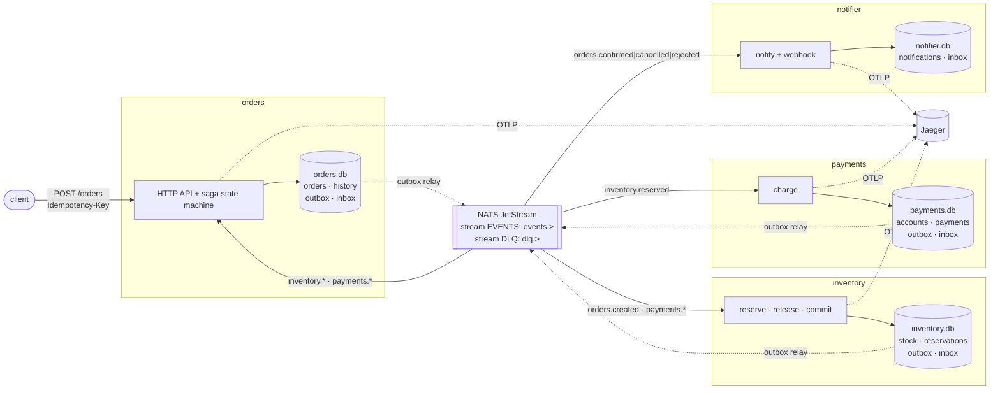
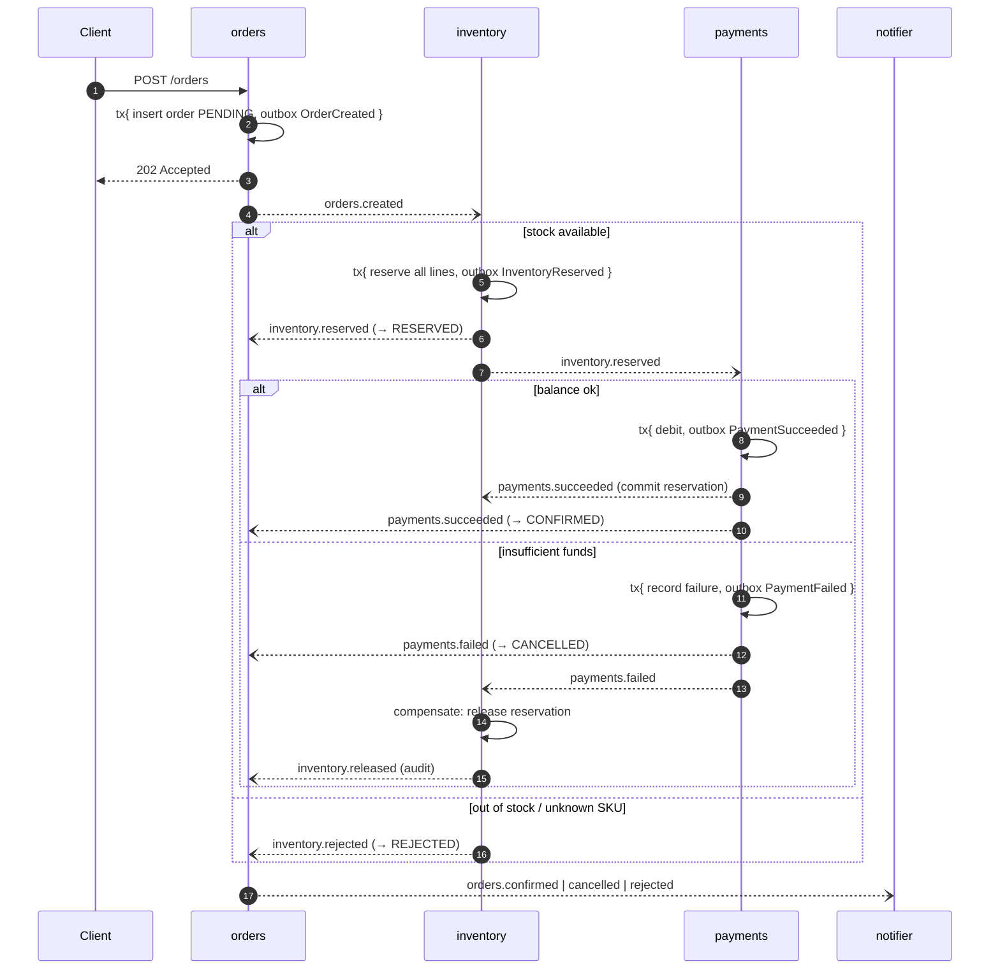

# event-driven-microservices

[](https://github.com/HOFFMAN-ALTERNATIVE/event-driven-microservices/actions/workflows/ci.yml)


[](LICENSE)

A reference architecture for **reliable event-driven microservices in Go**:
four services (orders, inventory, payments, notifier) that coordinate an order
**saga** purely through **NATS JetStream** events — with a **transactional
outbox**, **idempotent consumers**, **compensating transactions**, bounded
retries with back-off, a **dead-letter queue with replay**, and **one
OpenTelemetry trace per order across every service and every async hop**.

Everything runs with one `docker compose up`, and every failure mode below is
proven by an integration test against a real JetStream server in CI.

## Why

Most "microservices demos" publish an event right after `COMMIT` and call it a
day. That design silently loses or duplicates data the first time a process
crashes between the two steps, a broker blips, or a message is redelivered:

| Failure | What usually happens | What this project does |
|---|---|---|
| Crash after DB commit, before publish | Event lost forever, saga stuck | **Outbox**: event is part of the same SQL transaction; a relay publishes it later |
| Crash after publish, before marking sent | Duplicate event | `Nats-Msg-Id` = event id → JetStream de-dup window drops it |
| Broker redelivers (ack lost, timeout) | Double charge / double reservation | **Inbox table**: `(consumer, event_id)` inserted in the handler's transaction |
| Payment fails after stock was reserved | Stock leaks | **Saga compensation**: inventory releases the reservation |
| Downstream flaky (5xx, timeouts) | Hot retry loop or message dropped | NAK with **exponential back-off + jitter**, attempt budget per consumer |
| Poison message / bug | Consumer blocked or message vanishes | **DLQ stream** with error, attempts, origin; `dlqctl replay` after the fix |
| "Where did my order get stuck?" | grep logs on 4 hosts | **W3C trace context** persisted in the outbox → single trace in Jaeger |

## Architecture



Each service owns its database (database-per-service, SQLite in WAL mode) and
never calls another service synchronously. The only shared contract is
[`internal/events`](internal/events/events.go) — envelope, subjects and
versioned payloads.

### The saga



The orders state machine ([`saga.go`](internal/orders/saga.go)) is total and
**monotonic**: late, duplicated or reordered events never move an order
backwards or out of a terminal state (property-tested over 10k random event
sequences).

## Features

- **Transactional outbox** ([`internal/platform/outbox`](internal/platform/outbox/outbox.go)) — events are rows written in the business transaction; a relay publishes them in commit order, waits for the JetStream `PubAck`, stops at the first failure (no reordering), backs off exponentially and prunes old rows. `Kick()` after commit gives near-zero latency without hot polling.
- **Effectively-once processing** ([`internal/platform/messaging`](internal/platform/messaging/consumer.go)) — inbox insert + handler + follow-up outbox writes commit atomically; ack happens after commit; duplicates are acked without side effects. Business-level guards (one reservation / one payment per order) add defence in depth.
- **Retries & DLQ** — transient errors are NAKed with `250ms·2ⁿ ± 20%` (capped) back-off; `messaging.Permanent(err)`, malformed envelopes or an exhausted attempt budget publish to `dlq.<consumer>` with `Dlq-Error`, `Dlq-Attempts`, `Dlq-Original-Subject`, `Dlq-Stream-Seq` and the original trace headers, then `TERM` the message. Server-side `MaxDeliver` is unlimited on purpose so a crash on the last attempt can never make JetStream drop a message silently. Handler panics are recovered and retried.
- **DLQ tooling** — `dlqctl list [-consumer x]`, `dlqctl replay <seq>…`, `dlqctl replay -all`. Replays keep the event id (so idempotency still holds) but use a fresh `Nats-Msg-Id` so the de-dup window does not swallow them.
- **Saga + compensation** — all-or-nothing reservations, release on payment failure, commit on success; full saga history per order (`GET /orders/{id}`).
- **OpenTelemetry** — `otelhttp` server spans, producer spans per publish, consumer spans per delivery (attempt, consumer group, duplicate / dead-letter flags), trace context persisted with each outbox row and carried in NATS headers. `trace_id`/`span_id` are added to every JSON log line. OTLP/gRPC export to Jaeger in compose.
- **Safe HTTP API** — strict JSON decoding (unknown fields rejected, 1 MiB cap), validation, `Idempotency-Key` for client retries (race-safe via a unique index), `202 Accepted` + `Location` for the async workflow, `/healthz` and `/readyz` (NATS status + outbox backlog).
- **Invariants in the schema** — `CHECK (available >= 0)`, `CHECK (balance_cents >= 0)`: even a logic bug cannot oversell or overdraw.
- **Ops-friendly** — idempotent stream/consumer provisioning on boot (start order irrelevant), infinite NATS reconnect, graceful shutdown that drains consumers and flushes traces, one distroless non-root image for all binaries, chaos switch `PAYMENTS_FAILURE_RATE`.

## Quick start

```bash
docker compose up -d --build --wait
./scripts/smoke.sh          # happy path, rejection, compensation, trace check

# place an order
curl -s localhost:8081/orders -H 'Content-Type: application/json' \
  -H 'Idempotency-Key: demo-1' \
  -d '{"customer_id":"alice","amount_cents":12999,"items":[{"sku":"sku-keyboard","qty":2}]}'

curl -s localhost:8081/orders/<id> | jq        # status + saga history
curl -s localhost:8082/stock | jq              # inventory
curl -s localhost:8083/accounts/alice | jq     # balance
curl -s localhost:8084/notifications | jq      # notifications
open http://localhost:16686                    # Jaeger: one trace per order

# chaos: 30% of payment attempts fail transiently -> watch retries in Jaeger
PAYMENTS_FAILURE_RATE=0.3 docker compose up -d payments

# dead letters
go run ./cmd/dlqctl list
go run ./cmd/dlqctl replay -all -consumer payments
```

| Service | Port | Endpoints |
|---|---|---|
| orders | 8081 | `POST /orders`, `GET /orders/{id}`, `GET /orders?status=` |
| inventory | 8082 | `GET /stock`, `GET /stock/{sku}`, `PUT /stock/{sku}` |
| payments | 8083 | `GET/PUT /accounts/{id}`, `GET /payments/{order_id}` |
| notifier | 8084 | `GET /notifications?order_id=` |
| NATS | 4222 / 8222 | client / monitoring |
| Jaeger | 16686 | UI |

Configuration (env): `NATS_URL`, `DB_PATH`, `HTTP_ADDR`, `OTEL_EXPORTER_OTLP_ENDPOINT`, `LOG_LEVEL`,
`INVENTORY_SEED` (`sku=qty,…`), `PAYMENTS_DEFAULT_BALANCE_CENTS`, `PAYMENTS_FAILURE_RATE`, `WEBHOOK_URL` (notifier).

## Project layout

```
cmd/                     orders · inventory · payments · notifier · dlqctl
internal/events          wire contract: envelope, subjects, versioned payloads
internal/platform/
  outbox                 transactional outbox + relay
  messaging              idempotent consumer runner, retries, DLQ
  telemetry              OTel setup, NATS header carrier, trace-aware slog
  natsx · db · service   JetStream topology, SQLite, shared service runtime
internal/{orders,inventory,payments,notifier}   domain logic + HTTP
internal/dlq             DLQ list / replay
test/integration         full-system tests against real JetStream
```

## Design decisions & trade-offs

- **Choreography with an observing state machine** rather than a central orchestrator. Services react to facts; orders only *tracks* the saga. This keeps services decoupled and independently deployable; the cost is that the workflow is spread across handlers, which the sequence diagram above, the saga history table and distributed tracing compensate for. A dedicated orchestrator (or Temporal) becomes preferable once flows branch heavily.
- **Outbox over "publish then commit" or 2PC.** It needs only a local transaction and gives at-least-once publishing; JetStream de-dup plus inbox tables turn that into effectively-once *effects*. Polling adds up to `Interval` latency in the worst case, which `Kick()` removes for the common path; CDC (Debezium-style log tailing) would remove polling entirely at the cost of more infrastructure.
- **Idempotency in the consumer, not just the broker.** The de-dup window is time-bounded (2 min); the inbox is not. Both exist because each covers a different failure.
- **SQLite per service.** Zero-ops, real ACID transactions, trivially reproducible tests, and it keeps the focus on messaging semantics. A single connection serialises writers, which matches SQLite's model. Swapping to Postgres touches only `internal/platform/db` and the SQL dialect; with multiple replicas per service, add `SELECT … FOR UPDATE SKIP LOCKED` to the relay.
- **One `EVENTS` stream with subject-filtered durable consumers** (multi-filter consumers, NATS ≥ 2.10) instead of a stream per service — simpler retention and replay; per-domain streams are a drop-in change in `natsx` if limits need to differ.
- **Client-side attempt counting + explicit DLQ** instead of JetStream `MaxDeliver` advisories: the dead-letter record carries the actual error and the trace, and nothing is ever dropped silently.
- **Carry-forward payloads** (inventory passes customer/amount to payments) instead of synchronous lookups: no runtime coupling, at the price of slightly larger events. Payloads are versioned (`…V1`) for additive evolution.
- **Notifier webhook inside the handler transaction** is the one non-transactional side effect; it is made safe by sending the event id as `Idempotency-Key`. 4xx → permanent (DLQ), 5xx/429/timeouts → retry.

## Testing

```bash
make test          # unit tests (race detector)
make integration   # full system; uses $NATS_URL or an embedded nats-server
make lint          # golangci-lint (gosec, errorlint, revive, …)
make up smoke down # docker compose end-to-end
```

The integration suite boots all four services in-process against **real
JetStream** and asserts:

| Test | Proves |
|---|---|
| `HappyPathConfirmsOrderAndTracesEndToEnd` | saga completes, stock committed, balance debited, notification sent, **all spans of 4 services share the HTTP request's trace id** |
| `OutOfStockRejectsWithoutTouchingPayments` | rejection path, unknown SKU, payments never invoked |
| `PaymentFailureCompensatesInventory` | compensation restores stock exactly, saga history records it |
| `NoOversellUnderConcurrency` | 12 concurrent orders for the last unit → exactly 1 confirmed |
| `IdempotencyKeyAndDuplicateDelivery` | HTTP idempotency key; forced redelivery of `OrderCreated` changes nothing; JetStream de-dup reports `Duplicate` |
| `TransientFailuresAreRetriedWithBackoff` | 2 failed attempts + success, nothing dead-lettered |
| `PoisonMessagesAreDeadLetteredAndReplayable` | garbage and permanent failures land in the DLQ with diagnostics; replay after the fix resumes the saga |
| `WebhookRetriesThenDelivers` | 503 → retry → delivered with `Idempotency-Key` |

Unit tests cover the outbox relay (ordering, stop-on-failure, atomicity,
pruning), the consumer runner (duplicates, rollback, back-off, DLQ, panics,
DLQ outage), trace propagation, every domain handler and the saga state machine.

CI runs lint, unit tests on Go 1.23 and 1.24, the integration suite against a
NATS container **and** an embedded server, and a docker-compose end-to-end
smoke test that also verifies the distributed trace through Jaeger's API.

## License

[MIT](LICENSE) © Herman Hoffman
